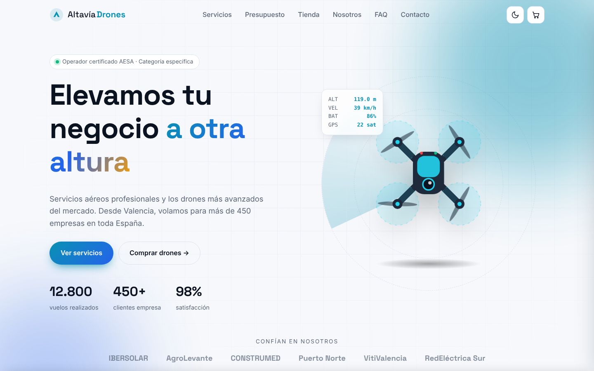
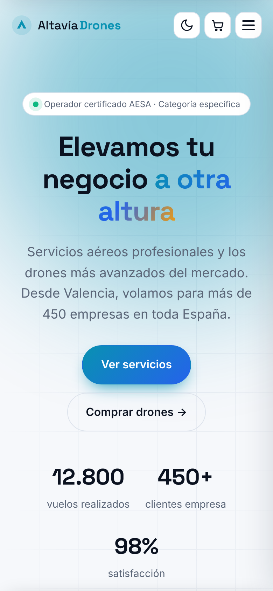

# Altavía Drones — Web corporativa

  
  

Página web de ejemplo (datos ficticios) de una empresa de **servicios con drones** y **venta de drones y accesorios**.

Abre `index.html` en el navegador; no necesita instalación ni servidor.

## Funcionalidades
- Hero animado con dron en SVG, HUD de telemetría y parallax con el ratón
- Servicios filtrables por sector con ficha de detalle en ventana modal
- Calculadora de presupuesto en tiempo real (cantidad, extras y zona)
- Tienda con búsqueda, filtros por categoría y precio, ordenación y ficha de producto con selector de color
- Comparador de hasta 3 drones
- Carrito lateral persistente (localStorage), barra de envío gratuito y checkout simulado
- Testimonios en carrusel (táctil), FAQ en acordeón, contadores animados
- Formulario de contacto con validación, newsletter y notificaciones
- Tema claro/oscuro y diseño responsive

## Archivos
- `index.html` — estructura
- `styles.css` — estilos
- `script.js` — datos e interactividad
- `capturas/` — capturas de la web e imagen de vista previa para compartir (`vista-previa.png`, 1280 × 640)
